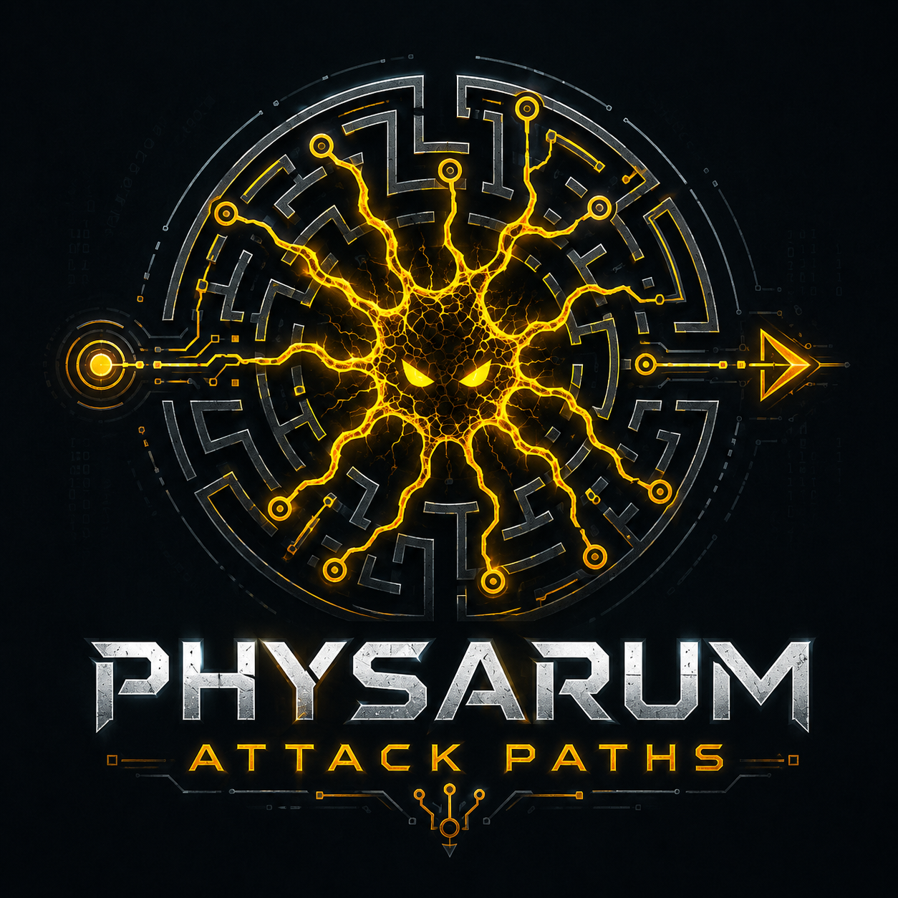

# physarum-attack-paths

[](./LICENSE)
[](https://github.com/fabioschorn/physarum-attack-paths)
[](https://www.rust-lang.org/)
[](https://github.com/fabioschorn/physarum-attack-paths/releases)
[](https://github.com/fabioschorn/physarum-attack-paths/actions/workflows/ci.yml)

> **Self-propagating bio-inspired attack-path organism for controlled security research.** A Rust research prototype that turns local network observations, adaptive sensing, pattern evidence, LLM-driven exploit selection, policy decisions, and cryptographic lineage memory into a living, chain-propagating organism.

<p align="center">
  
</p>

`physarum-attack-paths` studies how a distributed organism can discover and prioritize viable security paths in changing environments. Instead of treating a scan as a static snapshot, the system collects evidence from ports, banners, HTTP patterns, packet/eBPF stimuli, runtime observations, LLM recommendations, policy-gate decisions, and lineage history.

The project is inspired by *Physarum polycephalum*, a slime mold that reinforces useful paths and abandons weak ones. This repository does **not** simulate slime mold biology. It borrows the reinforcement/decay intuition and applies it to controlled attack-path research.

> **Scope:** controlled research prototype — local labs, Docker labs, owned AWS lab VPCs only. See [`General-Docs/ROADMAP.md`](./General-Docs/ROADMAP.md) for safety policy.

---

## Documentation

| Document | Purpose |
|---|---|
| [`General-Docs/ROADMAP.md`](./General-Docs/ROADMAP.md) | Current status, evidence pipeline, labs, roadmap, planned evolution, safety and scope |
| [`General-Docs/CHANNEL_SECURITY_DESIGN.md`](./General-Docs/CHANNEL_SECURITY_DESIGN.md) | Channel security stack (v0.5.4): AES-256-GCM lineage, SCP delivery, mTLS back-channel, HTTPS dashboard |
| [`General-Docs/GATE_N0_THREAT_MODEL.md`](./General-Docs/GATE_N0_THREAT_MODEL.md) | Gate N.0 — secure organism continuity: threat model, 4-pillar security design, invariants |
| [`General-Docs/PHYSARUM_SCANNER_DESIGN.md`](./General-Docs/PHYSARUM_SCANNER_DESIGN.md) | physarum-scanner — SensingProfile variants, SensingResult evidence model |
| [`General-Docs/ROLE_FLUID_AGENT_ARCHITECTURE.md`](./General-Docs/ROLE_FLUID_AGENT_ARCHITECTURE.md) | Role-fluid agent design and eBPF architecture intent |
| [`General-Docs/EBPF_FLOW_OBSERVATION_DESIGN.md`](./General-Docs/EBPF_FLOW_OBSERVATION_DESIGN.md) | eBPF Stage 0 — Aya stack, TCP tracepoint, sidecar model |
| [`General-Docs/NUCLEI_REEVALUATION_FOR_PHYSARUM_SPORE.md`](./General-Docs/NUCLEI_REEVALUATION_FOR_PHYSARUM_SPORE.md) | How Nuclei templates were adapted into physarum-sporangium |
| [`General-Docs/SPORANGIUM_TEMPLATE_CATALOG_AND_LLM_INTEGRATION.md`](./General-Docs/SPORANGIUM_TEMPLATE_CATALOG_AND_LLM_INTEGRATION.md) | Sporangium catalog structure and LLM integration design |
| [`crates/physarum-llm/DESIGN.md`](./crates/physarum-llm/DESIGN.md) | physarum-llm — two-turn LLM flow, PolicyGate, secret handling, evidence integration |

---

## Demo

Watch the organism in action — PF-6 Phase 2 lab run on v0.5.4.

A real LLM scans three containers, identifies vulnerabilities, propagates itself via SCP, and reports each colonization back to the seed through a mutual TLS channel. The live attack-path graph updates in the HTTPS dashboard as each hop is confirmed.

<p align="center">
  <video autoplay muted loop playsinline width="100%">
    <source src="https://raw.githubusercontent.com/fabioschorn/physarum-attack-paths/main/assets/movies/physarum-maze_lab1_container_only.mp4" type="video/mp4">
  </video>
</p>

> **Lab setup:** 1 seed + 3 target containers — Struts2 RCE (CVE-2020-17530), ProFTPD mod_copy (CVE-2015-3306), Spring4Shell (CVE-2021-31805). All three colonized in a single run.

---

## Conceptual model

The organism follows two principles.

First, the network is **observed**, not assumed. A host becomes interesting because the agent sees evidence: an open port, a banner, a service fingerprint, an ICMP/TCP/eBPF stimulus, a pattern finding, or a prior lineage result.

Second, the agent separates **evidence**, **proposal**, and **decision**.

```text
Evidence:   SensingResult, PortScan, PatternFindingSummary, VulnerabilityCandidate
Proposal:   LLM-generated PropagationStrategy or exploit-path proposal
Decision:   PolicyGate accepted/rejected result
Memory:     LlmAttemptEvidence and lineage
```

The LLM proposes. `PolicyGate` decides. Lineage remembers.

---

## Architecture

### Organism pipeline

```text
┌──────────────────────────────────────────────────────────────┐
│                         physarum-maze                        │
│                                                              │
│  startup_sensing / ICMP / TCP-eBPF stimulus                  │
│        │                                                     │
│        ▼                                                     │
│  physarum-scanner  →  SensingResult / PortScan               │
│        │                                                     │
│        ▼                                                     │
│  LLM Turn 1 — template selection                             │
│        │                                                     │
│        ▼                                                     │
│  physarum-sporangium  →  PatternFindingSummary               │
│        │                                                     │
│        ▼                                                     │
│  VulnerabilityIntelService  →  vulnerability_candidates      │
│        │                                                     │
│        ▼                                                     │
│  LLM Turn 2a — propagation strategy                          │
│        │                                                     │
│        ▼  (optional enrichment)                              │
│  LLM Turn 2b — Exploit-DB lookup + OgnlExec delivery         │
│        │                                                     │
│        ▼                                                     │
│  PolicyGate  →  bootstrap execution                          │
│        │                                                     │
│        ▼                                                     │
│  SCP __self__ (musl)  →  propagated agent (next hop)         │
│        │                                                     │
│        ▼                                                     │
│  LlmAttemptEvidence / lineage                                │
└──────────────────────────────────────────────────────────────┘
```

### Component roles

| Component | Role |
|---|---|
| `physarum-maze` | Organism controller: seed/propagated behavior, two-turn LLM evidence loop, policy-gated propagation, SCP self-replication, chain lineage, live graph server (`--server`, `--tls`) |
| `tls_store` | Ephemeral PKI: CA + mTLS back-channel cert + browser HTTPS cert; per-agent client cert issuance; `DistinguishedName` CN/O = "Physarum Attack Path" |
| `lineage_crypto` | AES-256-GCM encryption for `--lineage-b64` payload; per-run key, random nonce, key delivered via SSH session |
| `physarum-scan` / `physarum-scanner` | Native scanner — structured `SensingProfile` / `SensingResult` evidence |
| `physarum-spore` / `physarum-sporangium` | Nuclei-compatible evidence engine — HTTP/TCP template execution |
| `physarum-llm` | Provider-neutral LLM contracts — `TemplateSelectionQuery`, `DiscoveryQuery`, `PropagationStrategy`, `PolicyGate` |
| `VulnerabilityIntelService` | CVE enrichment layer (LocalAdvisoryCache + OsvFeed) |
| `physarum-ebpf` / observers | Runtime packet/flow stimuli |
| `formal/tla` | Formal models for scoring and path-safety properties |

---

## LLM and PolicyGate

`physarum-llm` supports mock and OpenAI-compatible client paths.

```env
PHYSARUM_LLM_ENDPOINT=https://api.openai.com
PHYSARUM_LLM_MODEL=gpt-4o-mini
LLM_API_KEY=...
PHYSARUM_LLM_LOG_PROMPTS=false
```

Policy rule:

```text
LLM proposes.
PolicyGate decides.
Lineage records.
```

Sensitive local files live under `examples/*/sensitive-info/` and must not be committed. See [`crates/physarum-llm/DESIGN.md`](./crates/physarum-llm/DESIGN.md) for contract boundaries and secret-handling rules.

---

## Mathematical core

The adaptive graph layer uses a Physarum-inspired reinforcement/decay model.

### Stimulus signal (`Q_ij`)

```text
latency_score = 1 / (1 + avg_rtt_ms / 100)
Q_ij = clamp(0.7 · success_rate + 0.3 · latency_score, 0, 1)   [0 if success_rate = 0]
```

### EMA-smoothed signal (`q_ema`)

```text
q_ema(t+1) = 0.3 · Q_ij + 0.7 · q_ema(t)
```

### Edge conductivity (`D_ij`)

```text
f(x) = x² / (1 + x²)
D_ij(t+1) = clamp(D_ij(t) + f(q_ema) · (1 - D_ij) - 0.1 · D_ij, 0, 1)
```

Steady state under sustained successful probes: `D* ≈ 0.833`. The TLA+ models in `formal/tla/` verify scoring variables remain bounded.

---

## Repository layout

```text
crates/           Rust workspace: protocol types, scanner, sporangium, LLM, maze organism
examples/         Local, Docker, and AWS validation labs + committed evidence files
formal/           TLA+ models for scoring and path-safety properties
General-Docs/     Design documents and threat models
Utilities/        Build, validation, Docker Lab, release, and helper scripts
.github/          CI and release automation
```

---

## Quick start

> Research prototype. Do not deploy on production hosts.

### Prerequisites

- Rust 1.86+ (pinned via `rust-toolchain.toml`)
- Docker Desktop ≥ 4.25 or Docker Engine ≥ 24 with Compose v2
- Linux or macOS development host

### Build and test

```bash
./Utilities/check-env.sh
./Utilities/build.sh
cargo test --workspace
```

### Docker Maze Labs — [`examples/`](./examples/)

```bash
# Default — organic startup sensing, mock LLM
./Utilities/docker-lab.sh --clean
./Utilities/docker-lab.sh

# With real LLM
cd examples/pf-4-real-llm-lab/sensitive-info
cp .env.example .env.local  # edit with your provider key
source .env.local && cd ../../../..
./Utilities/docker-lab.sh
```

### PF-6 Lab — chain propagation + live graph

```bash
# Phase 1: LLM sensing + CVE identification (plain HTTP dashboard)
./docker/pf6-lab.sh
# Open http://localhost:8080/ to watch the graph grow in real time

# Phase 2: SCP propagation + mTLS back-channel + HTTPS dashboard
./docker/pf6-lab.sh --phase2
# Open https://localhost:8443/ (click Advanced → Proceed on first visit)
# Browser cert CN/O: "Physarum Attack Path" — issued by "Physarum Attack Path CA"
```

Validated chain (Phase 2, v0.5.4): `172.21.0.2 (seed) → 172.21.0.3 CVE-2020-17530 → 172.21.0.4 CVE-2015-3306 → 172.21.0.5 CVE-2021-31805` — all three targets report colonization via mTLS back-channel with HTTPS active.

---

## Development workflow

```bash
./Utilities/check-env.sh
./Utilities/build.sh --check
./Utilities/build.sh --clippy
```

Every pull request must pass:

```text
cargo fmt --all -- --check
cargo clippy --workspace --all-targets -- -D warnings
cargo build --workspace
cargo test --workspace
```

Git helper scripts in `Utilities/git-scripts/`: `commit.sh`, `checkpoint.sh`, `release.sh`.

---

## References

1. Tero et al. (2007). *A mathematical model for adaptive transport network in path finding by true slime mold.* Journal of Theoretical Biology, 244(4), 553–564.
2. Becchetti et al. (2013). *Physarum can compute shortest paths.* ICALP.
3. Liu et al. (2017). *An improved Physarum polycephalum algorithm for the shortest path problem.* Scientific World Journal.
4. Nakagaki, T., Yamada, H., Tóth, Á. (2000). *Maze-solving by an amoeboid organism.* Nature, 407(6803), 470.
5. Zhao et al. (2026). *AI Agents Enable Adaptive Computer Worms.* arXiv:2606.03811. University of Toronto / Vector Institute.

---

## License

Licensed under the [PolyForm Noncommercial License 1.0.0](./LICENSE).

Permitted for academic research, education, and security testing in owned and authorized lab environments. Commercial use requires a separate agreement. Contact: fabio.schorn@expertsonline.com.br

---

## Contributing

Security issues should be reported according to [SECURITY.md](./SECURITY.md).

---

*"The slime mold has no brain, no nervous system, no central authority. It solves the maze anyway."*
